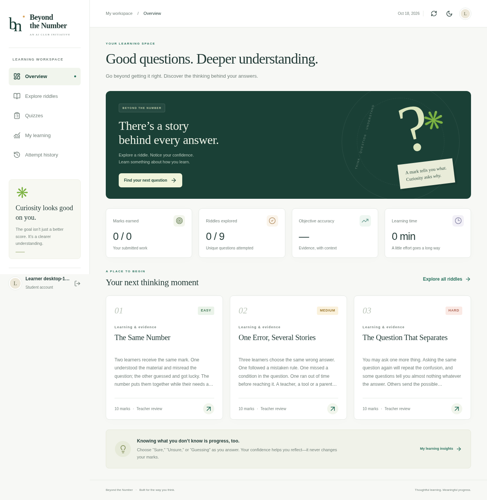

This just testing project

# Beyond the Number
### AI-CLUB-BY-CODEX · Understand the thinking behind the answer

A working full-stack formative assessment platform based on Eklavy Patel’s **Beyond the Number** research and four supplied learning riddles. Students explore questions, record confidence, save work, take timed quizzes and revisit feedback. Teachers maintain a question bank, assign quizzes, grade reflections and inspect learning evidence.

**Research honesty:** the four original riddles are open-ended reflections, not puzzles with one secret answer. They receive rubric-based teacher grading. Three clearly labeled, authored practice questions demonstrate automatic grading and diagnostic probes. No trained AI classifier or empirically validated psychological diagnosis is claimed.



*Screenshots use synthetic test accounts. They are evidence of local interface review, not a live deployment.*

## What is included

- Student registration; shared student/teacher login; Argon2 password hashing; revocable 12-hour opaque sessions.
- Student dashboard, searchable/filterable questions, confidence capture, optional hints with backend deductions.
- Timed quizzes with assignments, randomized question order, autosave, manual save and submission confirmation.
- Backend answer checking, explicit accepted text variants, immutable question snapshots and idempotent submission.
- Teacher question create/edit/publish/archive; atomic CSV/JSON imports with templates and useful errors.
- Teacher quiz creation/editing/assignment, manual reflection review, individual/class reports and CSV export.
- Topic/difficulty progress, confidence/accuracy charts, attempt history, provisional marks and personal report download.
- Responsive desktop/mobile UI, keyboard controls, light/dark themes, empty/loading/error states.
- PostgreSQL deployment support, SQLite local development, Alembic migrations, OpenAPI, deployment configurations and automated tests.

## Run on Ubuntu

Requires **Python 3.12+**, **Node 22.12+** (tested with Node 24), npm and Git. The basic setup uses SQLite, so you do not need a database service yet.

```bash
git clone https://github.com/EklavyPatel/AI-CLUB-BY-CODEX.git
cd AI-CLUB-BY-CODEX
python3 -m venv .venv
source .venv/bin/activate
python -m pip install -r backend/requirements-dev.txt
npm ci
cd backend
alembic upgrade head
python -m app.cli teacher
python -m app.cli seed
python -m uvicorn app.main:app --reload --port 8000
```

The teacher command prompts securely for a new password. The seed command asks for that teacher’s email and adds the four source riddles and three labeled practice examples. It is safe to run seed again; it preserves existing questions. Public registration always creates **students**; creating teachers is an administrative CLI action.

In a **second terminal**, from the repository root:

```bash
npm run dev
```

Open the frontend in your own browser on port 5173. The Vite proxy forwards `/api` requests to port 8000. The backend’s `/docs` provides interactive API documentation. The onboarding chat does not provide a public preview URL.

### First steps

1. Log in using the teacher you created. Inspect **Question bank** and edit a rubric or create a question.
2. Register a student in another browser profile. Try a practice question and submit a source reflection.
3. As teacher, open **Review & grade**, assign marks and write specific feedback.
4. Publish a quiz and assign students. Leave assignments empty to make it available to all registered students.
5. Revisit **My learning** / **Class insights**. Marks for pending reflections are visibly provisional.

For PostgreSQL, set `DATABASE_URL` before migrating or starting the backend. Uvicorn can load `backend/.env` with `--env-file .env`; the Alembic/CLI commands read process environment variables, so export those variables in your shell first. See [deployment](docs/DEPLOYMENT.md).

## Tests

```bash
# From root, with the virtual environment active:
(cd backend && python -m pytest -q)
npm test
npm run build
```

Browser tests require an isolated database, a running API and frontend. See [testing](docs/TESTING.md). They exercise real registration, scoring, review, authoring, import validation, quiz assignment and export on desktop and mobile Chromium. Never point test suites at real learner data; the PostgreSQL test fixture creates and drops tables.

## Repository map

```text
frontend/src/       React screens, shared UI, API client, CSS and component tests
frontend/e2e/       End-to-end browser tests
backend/app/        FastAPI routes, models, validation, auth and pure scoring rules
backend/tests/      API, scoring, permission and persistence tests
backend/alembic/    Versioned database migrations
scripts/           Isolated browser-test preparation
docs/              Research, solutions, API, architecture, deployment and final report
docs/sources/      Unmodified uploaded PDFs
```

## Documentation

- [Research analysis](docs/RESEARCH_ANALYSIS.md) and [riddle solutions](docs/RIDDLE_SOLUTIONS.md)
- [Architecture and security](docs/ARCHITECTURE.md)
- [API guide and import format](docs/API_DOCUMENTATION.md)
- [Deployment](docs/DEPLOYMENT.md) and [test instructions](docs/TESTING.md)
- [Implementation plan](docs/IMPLEMENTATION_PLAN.md) and [final report](docs/FINAL_REPORT.md)

## Deployment status

Deployment configuration is provided for Vercel + Render + PostgreSQL. No external deployment has been performed and no live website URL is claimed. Provisioning paid resources or connecting deployment accounts requires your authorization. This is an institution-scoped formative tool, not a high-stakes examination system. Review the documented limitations before a real student pilot.
