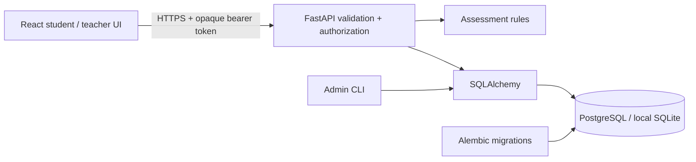

# Architecture

## Stack and tradeoffs

React 19 with Vite and Tailwind 4 follows the requested frontend stack. Shared CSS adds a consistent visual design without a component framework. Lucide icons are the only additional runtime UI dependency. Charts use semantic HTML/CSS bars with numeric labels and keyboard-focusable evidence tooltips, keeping chart data auditable and the bundle small.

FastAPI provides validated REST endpoints and automatic OpenAPI. SQLAlchemy supports both PostgreSQL (hosted) and SQLite (simple local setup); Alembic manages versioned schema changes. Python’s pure assessment module keeps scoring logic independently testable. Argon2 password hashing uses pwdlib. No paid AI provider is necessary.

## Database

| Table | Purpose |
| --- | --- |
| users | Unique normalized email, name, Argon2 hash, student/teacher role |
| auth_sessions | SHA-256 of a cryptographically random bearer token, user FK, 12-hour expiry |
| questions | Teacher owner, validated JSON content, publish/archive state |
| quizzes | Teacher owner, question IDs, assigned student IDs, timer and release/order policies |
| attempts | Student and optional quiz FK, immutable item snapshots, responses/confidence, hints, results, timestamps/deadline |
| login_limits | Hashed source/account rate-limit key, window timestamp and count |

JSON question content supports heterogeneous answer types and versioned snapshots without a table per type. Quiz membership and assignment lists are validated against existing records on creation/update. They are JSON lists, not relational join tables; this keeps a small single-institution pilot easy to maintain. Move them to join tables before complex roster management. Foreign keys cover core ownership relationships; SQLite enables FK enforcement in the application engine.

## Assessment lifecycle

1. A student starts a published available question/assigned quiz. The backend copies current items into the attempt and records the deadline.
2. Students save drafts explicitly or after a short autosave debounce. The server accepts only known question IDs and valid option values.
3. Submission locks the attempt row on PostgreSQL. A repeated submit returns the previous result. Answer, confidence and hints are snapshotted; client-supplied grades are rejected.
4. If time has expired, only the last saved draft is scored. Expiry is reconciled on attempt/progress reads or writes, without relying on a live frontend or a background scheduler.
5. Choice/text answers are automatically checked; reflection responses wait for teacher grading. Unanswered questions receive zero.
6. Incorrect objective answers can receive a teacher-authored optional probe. Probe answers are one-shot and never change marks. Explanations are held until pending probes finish so feedback cannot coach the probe.
7. Teachers grade their own submitted reflections with rubric/feedback. The backend bounds marks and applies any hint deduction. Historical snapshots remain intact after bank edits or archive.

A published assigned quiz with hidden solutions blocks new practice starts for the same question, preventing that alternate route from bypassing release policy. A previously released answer cannot be made unknown; retakes are formative and are not a secure examination mode. Existing attempts retain their captured policy when a quiz is later edited or unpublished.

## Scoring and reports

`earned = max(0, question_marks − hint_cost)` for correct objective answers; zero for incorrect/unanswered. Teacher reflection grades allow partial credit, bounded by the original marks, then apply the hint deduction once. Confidence never modifies marks.

Text comparison applies Unicode NFKC, casefold and whitespace collapsing against configured variants. Semantic free-text answers belong in the reflection/manual path. Report percentage is earned/maximum across submitted attempts, including repeated attempts; pending grades are provisional zero. Accuracy is objective correct / answered objective responses only. It excludes subjective grades and unanswered items. Reports separately count pending, unanswered, attempted, correct and incorrect. Difficulty/topic views include evidence counts, and history preserves each attempt. Strength/next-step suggestions are transparent comparisons of current topic marks, not machine-learned diagnoses.

Attempt duration is server submission minus start time, clamped to the deadline for timed quizzes. This is elapsed session time, not active attention or per-question response time. Timing does not diagnose a learner.

## Security boundaries

- Public registration cannot set role. Teacher bootstrap is a CLI action requiring database administration access.
- Passwords use Argon2; tokens have 48 random bytes and only their hashes are stored in the database. Logout revokes the current token.
- Tokens are kept in browser sessionStorage, not URLs. They are exposed to scripts in the same origin: prevent XSS, keep dependencies current and serve via HTTPS. No cookie auth means there is no ambient cookie CSRF credential.
- All teacher routes enforce role; question/quiz mutations enforce ownership. Student attempts enforce student identity.
- Student question JSON uses an explicit allowlist; accepted answers, explanation, rubric, misconception keys and probe solutions are omitted. Templates are protected teacher endpoints, not public frontend assets.
- All imports validate every row before committing; 1 MB/100-item bounds, enum/answer integrity and unknown-field rejection. Reverse proxy upload/request limits should complement application validation.
- CSV exports escape formula-leading cells. User text is rendered through React escaping, never raw HTML.
- CORS uses explicit frontend origins. Production frontend headers include a CSP. Responses include no-store and nosniff. Request logs omit bodies, credentials and query strings.
- Authentication has persistent 15-request/15-minute account/source counters. Provider ingress limits are still needed for production scale; forwarded headers must only be trusted from the provider proxy.

The app is one institution, not multitenant: teachers can list registered student identities for assignment, and see submissions only to their owned questions. No teacher can fetch another teacher’s question solutions through the bank endpoint.

## Operational limits

SQLite is a single-process local path. PostgreSQL row locking is used for concurrent attempt mutation; high-volume concurrency and authentication-counter races require load testing and potentially atomic counter upserts or an ingress rate limiter. Retakes are allowed; no gradebook policy selects best/latest automatically. Lists are not paginated. There is no password reset/email verification, account deletion UI, automated backup, proctoring, offline mode, push notification, trained classifier or AI tutor. Institutions should establish account recovery/data retention before a real cohort. These are not implied by deployment configuration.
